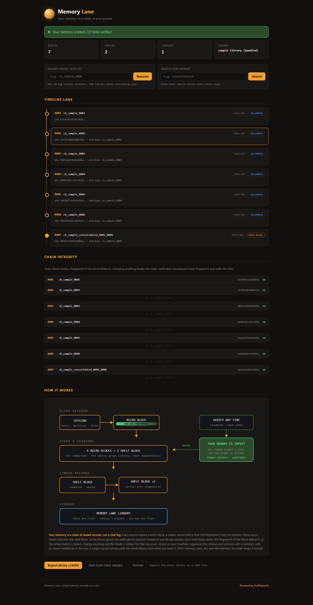
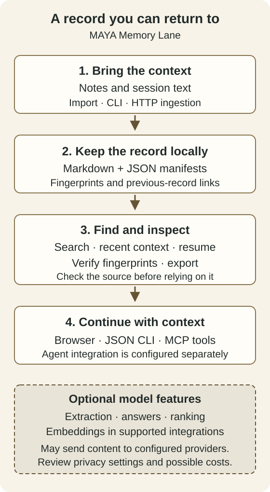

# MAYA Memory Lane

### Keep the record. Find the context. Pick up where you left off.

A local-first memory library for people and their AI agents. Save notes and
session records as readable files, find them again, and check whether their
recorded fingerprints still match.

**Your library is a folder, not an account.** Markdown records and JSON manifests
are the source of truth. The browser interface, command line, and agent tools
are different ways to use that same library.

[Try the demo](#try-the-demo) · [Save your first memory](#save-your-first-memory) ·
[Connect an agent](#agents-can-read-it-mcp-bridge) · [Limits and privacy](#limits-and-privacy)



*Fabricated sample data, bundled with the repository. A fresh start opens the
empty demo library; the sample loads on your own machine when you select it.*

## The idea in one minute

1. **Remember something.** Save a note, import a notes folder, or connect an
   ingestion script to your agent's session closeout.
2. **Keep the original.** Each appended record is stored as Markdown, with a
   SHA-256 fingerprint and a link to the preceding record in the manifest.
3. **Come back with context.** Search, open the source record, or ask an agent
   connected to the library to retrieve it. Verify the chain and export a JSON
   bundle when needed.

This is storage and retrieval, not automatic model training. Installing the
repository does not connect every conversation, run a background service, or
prove that a particular agent's live deployment is using it.

## How memory moves



**Text equivalent:** notes and session text enter through the importer, CLI, or
HTTP API. Ingestion appends a record to a local library. The web UI, JSON CLI,
and MCP tools read that library for search, recent context, resume, and export.
Optional extraction, answer synthesis, ranking, and embeddings can involve a
model service. The inbox watcher needs to be started separately.

## Try the demo

Install **Node.js 22 or newer**, then run:

```bash
git clone https://github.com/MAYA-Platform/MAYA-Memory-Lane.git
cd MAYA-Memory-Lane
npm start
```

Open **http://127.0.0.1:8766/** on the same machine. No `npm install`, account,
API key, or GPU is needed for browsing, basic search, verification, and export.
SQLite FTS5 is used when the Node runtime exposes `node:sqlite`; otherwise the
core falls back to substring search.

- Select **Load sample library** to explore the bundled seven-record example.
- Search for a word from a visible record and open the matching source.
- Inspect the chain status, then try the JSON export.
- **Start fresh** switches back to the empty demo. It is not a command to erase
  your external library.

The bundled demo libraries are read-only through the HTTP write endpoints.
Mount a separate library before saving your own records.

## Save your first memory

This cross-platform example creates a separate library in the parent directory
and saves one record without calling a model. Run it from the repository folder:

```bash
node -e "require('node:fs').cpSync('empty-library', '../my-memory-lane', { recursive: true, errorOnExist: true, force: false })"
node tools/ingest.mjs --library ../my-memory-lane --no-extract --text "Project Cedar: we decided to launch the demo on Friday." --title "Demo decision"
```

Use a new destination name if that folder already exists. Then stop the demo
server with Ctrl+C and open your library:

**macOS / Linux / Bash**

```bash
MEMORY_LANE_LIBRARY=../my-memory-lane npm start
```

**Windows PowerShell**

```powershell
$env:MEMORY_LANE_LIBRARY = "../my-memory-lane"
npm start
```

Search for **Cedar** in the browser. You should find the saved decision. Your
files remain in `../my-memory-lane`; back up that folder independently of this
repository. Export is useful, but is not a substitute for a tested backup.

## Limits and privacy

- **Local-first is not always offline.** The core read/write path works locally.
  Optional extraction and answer synthesis use the configured model endpoint;
  without an API key they try Ollama (local by default). Jev ranking and hosted
  embeddings can send queries or record content to their configured services.
  Review provider settings before handling private data. These services may
  charge separately; a free local code path does not make every feature free.
- **Fingerprints are not encryption or proof of truth.** Verification can detect
  mismatches against the manifest. Someone who can replace the records and
  manifest can rewrite that reference too. Protect and back up both. A resume
  phrase is a lookup aid, not a password or access-control mechanism.
- **Answers still need checking.** Search can miss a relevant record. A model can
  misread retrieved evidence; valid source IDs do not prove the answer is true.
  Open the cited source before relying on an important answer.
- **Keep the server local.** It binds to `127.0.0.1`. This is not a managed hosting
  service or an internet-facing multi-user deployment. See [SECURITY.md](SECURITY.md).
- **Storage is append-based.** The public core assigns six records per shelf
  folder; that is not automatic six-session summarization or deletion. Broader
  session closeout/compaction workflows need their own integration.
- **Source availability is not deployment evidence.** Agent integrations,
  watchers, model services, and scheduled ingestion must be configured and
  checked in your own environment.

## Pointing at your own library

The server reads the library selected by `MEMORY_LANE_LIBRARY`:

```bash
MEMORY_LANE_LIBRARY=/path/to/your/library node server.mjs
```

A library contains `MANIFEST.json` and a `shelves/` tree of Markdown records and
shelf manifests. The `empty-library/` folder provides the blank format;
`sample-library/` is a fabricated example (regenerate with `npm run make-sample`).
Optional embeddings can add a cache file inside the library. An ordinary notes
folder is not this format: import it into a separate destination instead.

### Bringing an existing notes folder in (Obsidian vault, docs tree)

An existing vault is its own format, so Memory Lane imports it rather than opening it in place. One command walks the folder and seals every markdown note as a searchable, chain-linked block in a fresh (or existing) library:

```bash
node tools/import-vault.mjs /path/to/your/vault --library /path/to/library
```

Eligible `.md` and `.txt` files become blocks titled from their first heading or filename. Re-running skips content already imported. Hidden files and folders, files over the size limit (200 KiB by default, adjustable with `--max-kb`), and very short notes are skipped. The importer reports new, skipped, and failed counts unless `--quiet` is used.

Read or append failures, a directory depth beyond 12, or more than 5,000 candidate files cause a nonzero exit, including in quiet mode. An unsuccessful run may already have imported some notes; it does not roll them back. The candidate limit applies on each run, so rerunning a larger vault will not necessarily reach the remaining files. Import larger vaults in smaller source folders and review the results; changing the source folder changes lineage and can create duplicates of notes previously imported from the parent folder.

The importer checks collected paths for collisions in its legacy 32-bit lineage before writing and stops if it finds one. This check covers only paths collected in the current scan; it cannot identify collisions with paths that are absent, skipped during traversal, present only in older imports, or imported separately from another source root. The hash uses the supplied source path and case, not a canonical file identity. Historical lineage values are retained for compatibility, so review older imports separately.

## How the chain works

`appendBlock()` writes a Markdown record, records its SHA-256 fingerprint, links
it to the preceding record, and updates the manifests. Shelf folders group six
records. Verification recomputes fingerprints and walks recorded links:

- **Intact:** recorded fingerprints and checked links match.
- **Unverifiable:** a reference lacks the recorded fingerprint needed to compare.
- **Needs attention:** a mismatch or missing referenced record needs inspection.

This is integrity checking against the files you hold, not an external witness
or a guarantee that the contents were accurate when written.

## Automatic ingestion

Ingestion must be connected to a source or started explicitly. Three entry points use the same append path:

**1. Inbox watcher (drop a file, walk away).** Point the watcher at a folder and it seals everything that lands there:

```bash
python tools/inbox-watch.py --inbox /path/to/inbox --library /path/to/library --once
```

New `.md`, `.txt`, `.json`, or `.log` files are extracted, sealed as chain-linked blocks, and archived to `inbox/processed/<date>/`. Run it on a timer (`python tools/inbox-watch.py --inbox /path/to/inbox --library /path/to/library --loop 60`, or use cron; `npm run watch` uses the `ML_INBOX` and `ML_LIBRARY` environment variables) and the library grows itself. When there are no new files, there is nothing to ingest. Extraction settings determine whether a model is contacted for new records.

**2. API (any agent can push a memory).** With an external library mounted, the server accepts new memories over HTTP:

```bash
curl -X POST http://127.0.0.1:8766/api/ingest \
  -H "Content-Type: application/json" \
  -d '{"text":"A customer leased a 2026 Honda Civic in matte black.","source":"telegram"}'
```

**Model-call note:** auto-extraction runs on `/api/ingest` unless you pass an explicit `facts` array. To avoid a model call, use `/api/blocks/write`, or provide `"facts": []`. Do not rely on `"extract": false` in the current HTTP handler; the CLI supports `--no-extract`. The response includes the new `lib_id`, `block_id`, and a fresh chain verdict.

**3. CLI (scripts and cron).** Same pipeline from the command line:

```bash
node tools/ingest.mjs transcript.md --library /path/to/library --source cli
cat notes.txt | node tools/ingest.mjs --library /path/to/library --title "Evening notes"
```

**How extraction works.** The code defaults to a DeepSeek-compatible hosted configuration when a key is supplied (`MEMORY_LANE_API_KEY` / `MEMORY_LANE_BASE_URL` / `MEMORY_LANE_MODEL`), falling back to local Ollama when no key is set. The model turns a raw transcript into a `## Extracted facts` section inside the block, and full-text search indexes those facts so natural-language queries land. Extraction is best-effort by design. If the model is unreachable, the raw text is still sealed and searchable, model failure does not itself prevent the raw record from being appended. Deduplication compares title, body, source, and lineage. Repeating the same values skips a duplicate; changing those fields can create a new record.

## Agents can read it (MCP bridge)

Memory Lane isn't just a UI, it's an **agent memory layer**. A zero-dependency MCP server (`tools/memory-lane-mcp.mjs`) exposes the live library to any MCP-capable agent (Claude Code, Codex, Cursor, Copilot, and others) as callable tools:

| Tool | What it does |
|---|---|
| `ml_search(query)` | Full-text search across all blocks, re-ranked for intent by Jev when a key is available (pass `rerank: "none"` to skip) |
| `ml_answer(question)` | Ask a natural-language question, exact match or synthesized from evidence |
| `ml_recent(limit)` | Digest of the most recent blocks (call at session start) |
| `ml_resume(phrase)` | Resolve a resume phrase to blocks |

Synthesized answers require the model to return a JSON answer and cite only IDs of blocks included in its evidence. Missing, malformed, or unknown IDs cause a source-excerpt fallback with a note; providers that do not follow this format will fall back more often. A valid ID establishes only that the block was supplied to the model, not that it supports the answer. If a selected block or its manifest entry changes while answering, search again; this is not an atomic snapshot across files.

The answer path rechecks the Jev candidate pool, including expanded siblings, before sending and after a response. The checks are sequential: a change can still occur between validation and transmission or after a check. This does not add an atomic egress boundary, and the separate search-reranking path does not use this answer-specific check.

Answer `cost` is `0` when no external provider call was attempted and `null` when the total charge is unknown. A direct answer can still follow an optional Jev ranking request. Provider billing is authoritative; token counts alone do not establish a charge.

### Query-time re-ranking (JevRank)

Search results include `manifest_hash_status` (`match`, `mismatch`, `missing`, or `invalid`) comparing the bytes used for an excerpt with the manifest hash. The JSON CLI `search` command includes this field, and MCP `ml_search` labels it for each result. A match does not establish the truth of the content, validate the chain, or authenticate the manifest. Existing missing block files are omitted from results. CLI `recent` and `resume` and MCP `ml_recent` and `ml_resume` also label each excerpt; `file_missing`, `read_error`, or `unavailable` indicate no readable block was available.

MCP `ml_recent` and `ml_search` default to five results and accept a positive safe-integer limit. Valid limits above 25 are capped and say so; unsafe integers are rejected. For nonempty results, `ml_recent` reports how many library entries were shown, while `ml_search` reports the number returned and notes that additional matches may exist; it does not claim a total match count. Empty results use a no-results message. Nonpositive, fractional and nonnumeric limits return an error (previously zero defaulted to five and negative values could select unintended results). Positive numeric strings remain accepted for existing clients. This is a record-count cap, not a byte, token or read-memory limit: manifest IDs and titles are not length-bounded, and each selected block is read to build its excerpt. `ml_resume` is not covered by this limit.

`/api/search` accepts an optional `rerank=jev` parameter. When set (and the MCP tools
do this by default whenever a decisions-provider key resolves), the server takes the
top full-text candidates and sends **one** batched request to the TypeSafe Jev
decisions model (`typesafe/jev-1.13` via the configured decisions gateway) asking it to score each
candidate's relevance to the query's intent (0-2). Results are re-ordered by that
score and annotated with `jev_score`, while the original full-text score is kept for
comparison. `GET /api/jevstats` reports process-lifetime attempts and attempted
questions, failures, and a partial cost estimate. An attempt records invocation of
fetch; it does not establish that the provider received the request. The historical `calls` and
`questions` counters include only responses with at least one usable score;
`pendingAttempts` counts requests still in progress; `unpricedAttempts` counts
completed attempts without such a response. `estimatedCostUsd`
combines nonnegative finite reported usage costs or a per-question estimate for those scored responses
and excludes pending and unpriced attempts. If the aggregate exceeds the numeric
range, it becomes `null` for the rest of the process lifetime. It is not a
provider billing receipt; failed
attempts may still incur charges. Missing fetch or a failing `onAttempt` callback can
increase `failures` without increasing `attempts`; a missing key or a source-change
check that stops before fetch is not counted as an attempt. The exported
`jevStats()` JavaScript function also returns `null` for an overflowed estimate,
so clients should handle the cost as a nullable number. Counters reset when the server restarts.

JevRank is strictly additive and defensive: if the key is missing, the model is
unreachable, or the request times out (3s cap), search returns the plain full-text
results unchanged. Configure the key via
`MERGE_API_KEY` or the `api_key:` line in your Hermes provider config. Keep provider credentials private.

### Connect the MCP server

Configure your MCP client's stdio server entry with `node` as the command,
`/absolute/path/to/MAYA-Memory-Lane/tools/memory-lane-mcp.mjs` as its argument,
and `MEMORY_LANE_LIBRARY=/absolute/path/to/your/library` in its environment.
The exact settings format depends on the client. No HTTP server is required
for this stdio bridge.

Ask the connected agent to search for a known phrase and check that it returns
the expected source record. MCP access makes the library available; it does not
make every agent use it automatically or write session records for you.

For Hermes-specific setup, see the [plugin instructions](hermes-plugin/README.md).
For optional automation design, see [session closeout](docs/SESSION_SEAL_CLOSEOUT_PIPELINE.md)
and [auto-observation](docs/AUTO_OBSERVATION_SPEC.md). A design document is not
proof that those components are active in your deployment.

## Benchmarks and research

Read the [side-by-side report](benchmarks/SIDE_BY_SIDE_REPORT.md),
[protocol](benchmarks/BENCHMARK_PROTOCOL.md), [runners](benchmarks/harness/),
[run logs](benchmarks/logs/), and [results](benchmarks/results/) together.
These are recorded experiments, not a guarantee of performance on your data or
a validation of the current deployment. The comparisons use different
preprocessing pipelines; the oracle and small paraphrase evaluations answer
different questions. Check the report's limitations before comparing scores.

<details>
<summary>Reproduce the recorded benchmark workflows (separate setup and possible provider costs)</summary>

From this repository:

```bash
cd benchmarks
# Dataset: huggingface.co/datasets/xiaowu0162/longmemeval-cleaned
# Read runner requirements and provider configuration before running.
python harness/run_all_lanes.py --all
python harness/run_lane_a_langmem.py
python harness/run_lane_a_mem0.py --clean
python harness/generate_sbs_report.py
```

These Python/provider workflows are separate from the dependency-free Node
application. Some require credentials, model services, or extra infrastructure.
The protocol and first report were committed together; do not treat that as an
independently witnessed preregistration.

</details>

## API

| Endpoint | Description |
|---|---|
| `GET /` | The Memory Lane interface |
| `GET /api/status` | Library stats + chain verdict |
| `GET /api/blocks` | Block list (manifest order) |
| `GET /api/blocks/:libId` | One block (frontmatter + body) |
| `GET /api/chain` | Full chain verification walk |
| `GET /api/search?q=` | Search across block bodies (add `&rerank=jev` for intent re-ranking) |
| `GET /api/answer?q=` | Ask a question, direct / synthesized / none (retrieval confidence gate) |
| `GET /api/resume?phrase=` | Resolve a resume phrase |
| `GET /api/jevstats` | JevRank process-lifetime attempts, failures, and partial cost estimate |
| `GET /api/export` | Deterministic JSON export |
| `POST /api/ingest` | Seal a new memory (auto fact extraction) |
| `POST /api/blocks/write` | Seal a new memory with explicit facts (no LLM) |

Search reads the bytes of every block listed in the loaded manifest to detect
changes, including edits that preserve file size and modification time. HTTP,
MCP and CLI searches use up to 16 simultaneous file reads. To bound memory,
only one async search in the process captures a corpus at a time; up to four
later searches wait and read fresh bytes when admitted. Further requests receive
an explicit busy error (HTTP 503). Disconnected HTTP searches propagate cancellation to the search queue;
already-started file reads may still finish before their slot is released. The direct JavaScript `search()` API
remains synchronous and is not subject to this async queue.

Each search excerpt and its manifest-hash status describe the bytes captured
for that result, even if a file changes before the response arrives. A search
is not an atomic snapshot across files: files may be captured at different times,
and a concurrent edit can appear in the next request. The optional Jev lineage
expansion reads additional records at expansion time. For answers, candidates
whose source or metadata changed after selection are omitted; if none survive,
retry the question. Hash agreement does not establish source truth or chain
authenticity. A caller that reuses a loaded library must reload it to discover
manifest changes.
If the active web library is switched while a search or answer is in progress,
the server returns HTTP 409 and the caller should retry against the new library.

## Optional model features

- **Extraction and answer synthesis:** see [`lib/extract.js`](lib/extract.js)
  and [`lib/answer.js`](lib/answer.js). Configure `MEMORY_LANE_API_KEY`,
  `MEMORY_LANE_BASE_URL`, and `MEMORY_LANE_MODEL` for a hosted endpoint.
  Without a key, the default is Ollama at `127.0.0.1:11434`; it must be installed
  and serving the selected model separately. Hardware needs depend on that model.
- **Ranking:** see [`lib/jevrank.js`](lib/jevrank.js). MCP uses Jev when a
  decisions-provider key resolves, including from an existing Hermes config.
  HTTP search requests opt in with `rerank=jev`.
- **Embeddings:** [`lib/embeddings.js`](lib/embeddings.js) contains optional
  local/Vertex support. Its presence does not mean the basic HTTP search route
  automatically uses dense retrieval.

The core application requires no external npm dependencies. The Python watcher,
Hermes host, benchmarks, and optional model services have their own requirements.
To run the repository's Node test suite: `npm test`.

## Repository layout

```text
lib/memoryLaneCore.js        library core: load, verify, search, resume, export, append
lib/extract.js               fact extraction: DeepSeek API (env vars) with Ollama fallback
lib/answer.js                answer gate: direct / synthesized / none (retrieval confidence)
lib/embeddings.js            optional hosted embeddings lane (FTS5 + dense hybrid, opt-in)
lib/observations.js          deterministic auto-observation (zero-LLM signal capture)
lib/injector.js              session-start snapshot injection
public/memory-lane.html      the interface (single file, zero deps)
server.mjs                   zero-dependency HTTP server (read + write + answer endpoints)
empty-library/               the blank first-run library (0 records, default)
tools/ingest.mjs             CLI ingestion: file, --text, or stdin
tools/import-vault.mjs       one-command import of an existing notes folder (Obsidian vault, docs tree)
tools/inbox-watch.py         inbox watcher: auto-seal files in a drop folder
tools/memory-lane-mcp.mjs    MCP server — any agent reads the library in real time
tools/memory-lane-cli.mjs    JSON CLI bridge (used by the Hermes MemoryProvider plugin)
tools/make-sample-library.mjs  deterministic sample library generator
tools/make-release-manifest.mjs  release manifest generator (file SHA-256 index)
hermes-plugin/               Memory Lane as a first-class Hermes memory provider
sample-library/              the bundled demo library (7 blocks, regenerable)
tests/                       Node test suites; see package.json for the current list
benchmarks/                  comparison protocol, reports, traces, and harness runners
docs/                        specs and design docs (auto-observation spec, etc.)
```

## Support & reporting issues

Found a bug or a sharp edge? Open an issue on this repository. For anything sensitive, use GitHub's **Private vulnerability reporting** (see [SECURITY.md](SECURITY.md)). Never put credentials or private data in a public issue.

If you want your own AI agent to investigate before you report, paste this prompt into your agent:

````text
Investigate a bug report for the MAYA Memory Lane repository. Reproduce
the issue locally if you can, then draft a bug report with: a concise
summary, steps to reproduce, expected behavior, actual behavior, environment
details (OS, Node version), and any relevant logs. Redact all credentials,
API keys, and personal data before showing me the draft. Do not post
anything anywhere without my explicit approval.
````

## License

MIT, see [LICENSE.txt](LICENSE.txt).

---

*Powered by 2ndNatureAi*
